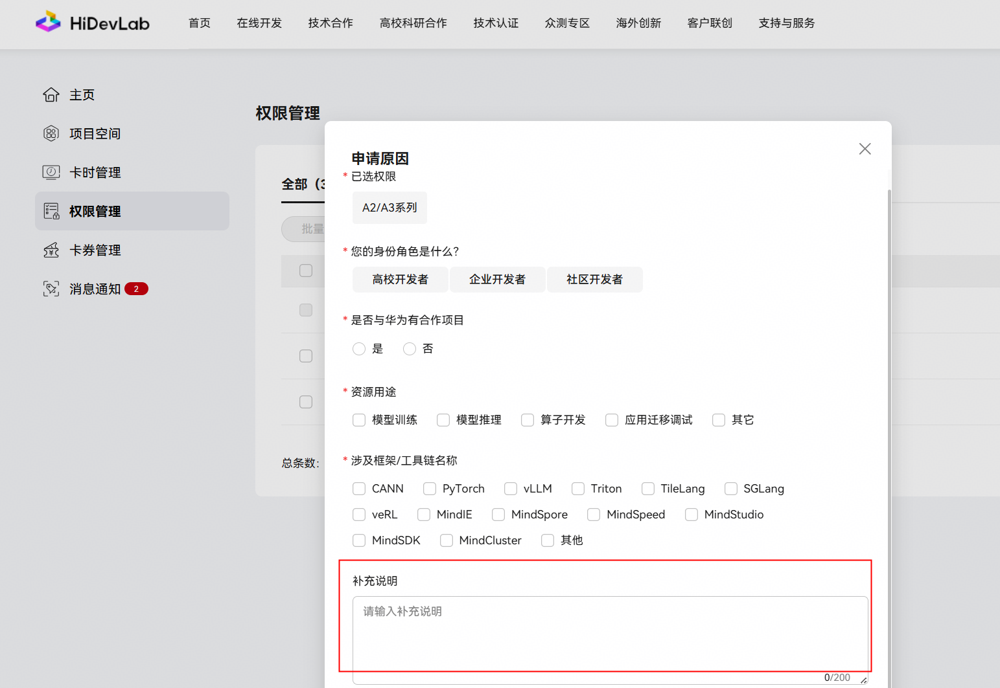
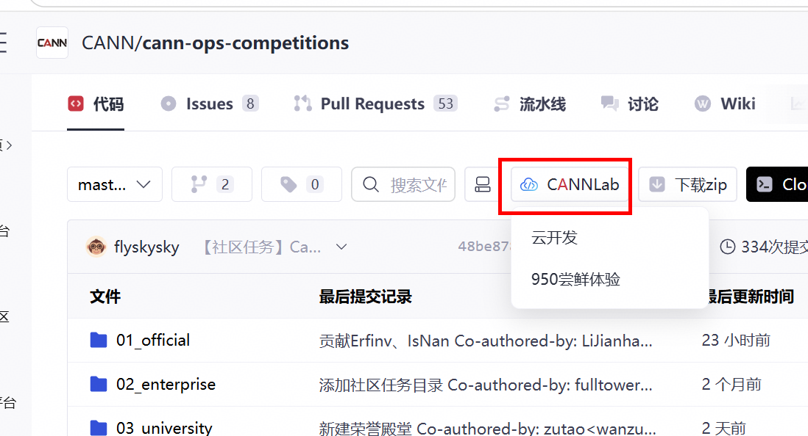

# aclblasCsyrkx 算子开发任务书

## 1 任务概述

在昇腾 NPU（Atlas 950PR）上使用 Ascend C 编程语言开发单精度复数（complex64）扩展对称秩 k 更新算子 `aclblasCsyrkx`，完成算子设计、开发、测试全流程工作。验收通过后合入昇腾算子开源仓（请参考链接：https://gitcode.com/cann/ops-blas ）。本任务为补齐 Blas 仓能力。

## 2 核心开发要求

### 2.1 功能实现要求

开发算子名为 aclblasCsyrkx，对标基线接口为 cuBLAS 的 cublasCsyrkx（legacy）。cublasCsyrkx 接口定义如下：

```cpp
cublasStatus_t cublasCsyrkx(
    cublasHandle_t handle,
    cublasFillMode_t uplo,
    cublasOperation_t trans,
    int n, int k,
    const cuComplex* alpha,
    const cuComplex* A, int lda,
    const cuComplex* B, int ldb,
    const cuComplex* beta,
    cuComplex* C, int ldc);
```

**数学公式**：

对称 rank-k 扩展更新：`C = alpha * op(A) * op(B)^T + beta * C`。trans=N 时 `op(A)=A`、`op(B)=B`（A、B 为 n×k），即 `C = alpha*A*B^T + beta*C`；trans=T 时 `op(A)=A^T`、`op(B)=B^T`（A、B 为 k×n），即 `C = alpha*A^T*B + beta*C`；**trans=C 与 trans=T 完全等价**（按转置处理，不取共轭）——syrkx 的结果矩阵是对称（非 Hermitian）矩阵，共轭转置会破坏对称性，cuBLAS `cublasCsyrkx` 对 `CUBLAS_OP_C` 亦按 `CUBLAS_OP_T` 执行（本批已在 P102 + CUDA 12.5 实测 trans=T 与 trans=C 的输出逐位相同）。C 为 n×n 对称矩阵，仅引用并更新 uplo 指定三角，alpha、beta 为复数标量，矩阵按列主序存储。

**算法说明**：

1. **对称更新**：C 为 n×n 对称矩阵，仅写入 uplo 指定三角（ACLBLAS_UPPER 只更新上三角，ACLBLAS_LOWER 只更新下三角）。
2. **op 三种取值**：trans=OP_N 时 A、B 均为 n×k，计算 C = alpha*A*B^T + beta*C；trans=OP_T 或 trans=OP_C 时 A、B 均为 k×n，均计算 C = alpha*A^T*B + beta*C（**OP_C 不取共轭，与 OP_T 完全一致**，与 cuBLAS `cublasCsyrkx` 行为相同）。
3. **标量处理**：alpha、beta 为复数标量指针，作用于结果。
4. **no-op 与零缩并维**：n=0 时 quick return 返回 ACLBLAS_STATUS_SUCCESS，不写 C；k=0 时仅对 uplo 指定三角执行 C = beta × C，不引用 A/B，另一三角不得改写。

**确定性计算要求**：算子需支持确定性计算，相同输入多次执行结果一致。判定方式见 §2.5「确定性计算要求」。

### 2.2 算子工程模式

使用 Ascend C kernel直调方式开发，基于 ops-blas 开源仓（请参考链接：https://gitcode.com/cann/ops-blas ）工程框架，实现 aclblasCsyrkx 句柄式 BLAS 接口，通过 handle 绑定 stream 直调 NPU kernel。本算子属 Level-3 对称 rank-k 更新族，基于 same 家族 GEMM kernel 直调，复用 Gemm 模板实现 A*B^T（trans=N）或 A^T*B（trans=T 或 OP_C，OP_C 与 OP_T 等价、不取共轭）乘积并累加 beta*C。开发目录见 §5。

### 2.3 接口定义

ops-blas 仓 `include/cann_ops_blas.h` 声明统一 `aclblasStatus_t` 句柄式 API，签名与 cuBLAS cublasCsyrkx 对标接口参数序列一致，维数用 `int`，标量（alpha/beta）用指针（`const aclblasComplex* alpha`）。禁止定义 950PR 私有平行接口。接口签名如下：

```cpp
aclblasStatus_t aclblasCsyrkx(
    aclblasHandle_t handle,
    aclblasFillMode_t uplo,     // ACLBLAS_UPPER / LOWER
    aclblasOperation_t trans,   // ACLBLAS_OP_N / OP_T / OP_C
    int n, int k,
    const aclblasComplex* alpha,
    const aclblasComplex* A, int lda,
    const aclblasComplex* B, int ldb,
    const aclblasComplex* beta,
    aclblasComplex* C, int ldc);
```

返回值类型为 `aclblasStatus_t`，语义见仓内 `include/cann_ops_blas_common.h`：`ACLBLAS_STATUS_SUCCESS` / `ACLBLAS_STATUS_INVALID_VALUE` / `ACLBLAS_STATUS_INVALID_ENUM` / `ACLBLAS_STATUS_HANDLE_IS_NULLPTR` 等。

### 2.4 参数说明

| 参数名 | 输入／输出/属性 | 描述 | 数据类型 | dtype类型 | 数据排布格式 | 维度(shape) | 值域范围 | 异常行为 |
| --- | --- | --- | --- | --- | --- | --- | --- | --- |
| handle | 输入 | aclblas 句柄，绑定 stream，用于直调 NPU kernel | scalar | - | - | - | 非空句柄 | handle 为空指针时返回 ACLBLAS_STATUS_HANDLE_IS_NULLPTR |
| uplo | 属性 | C 的三角引用方式，取 UPPER（上三角）或 LOWER（下三角） | attr | int | - | - | ACLBLAS_UPPER、ACLBLAS_LOWER | 取 ACLBLAS_UPPER、ACLBLAS_LOWER 之外的枚举时返回 ACLBLAS_STATUS_INVALID_VALUE |
| trans | 属性 | A、B 的运算方式，取 N（不转置）、T（转置）或 C（**与 T 等价，不取共轭**） | attr | int | - | - | ACLBLAS_OP_N、ACLBLAS_OP_T、ACLBLAS_OP_C | 取 ACLBLAS_OP_N、ACLBLAS_OP_T、ACLBLAS_OP_C 之外的枚举时返回 ACLBLAS_STATUS_INVALID_VALUE |
| n | 属性 | C 的阶数，即对称矩阵 C 的行/列数，也即 A、B 的行数（trans=N）或列数（trans=T/C） | attr | int | - | 标量 | ≥ 0（int 可表示范围） | n 为负值时返回 ACLBLAS_STATUS_INVALID_VALUE |
| k | 属性 | 缩并维，即 A、B 的列数（trans=N）或行数（trans=T/C） | attr | int | - | 标量 | ≥ 0（int 可表示范围） | k 为负值时返回 ACLBLAS_STATUS_INVALID_VALUE |
| alpha | 输入 | 复数标量乘子，实部/虚部各为 FLOAT32 | scalar | COMPLEX64 | - | 标量 | 实部/虚部取值于 FLOAT32 全集 | alpha 为空指针时返回 ACLBLAS_STATUS_INVALID_VALUE |
| A | 输入 | 输入矩阵，列主序，元素为复数；trans=N 时为 n×k，trans=T/C 时为 k×n | tensor | COMPLEX64 | ND | trans=N 时为 n×k，trans=T/C 时为 k×n | 实部/虚部取值于 FLOAT32 全集 | n>0 且 k>0 时 A 为空指针返回 ACLBLAS_STATUS_INVALID_VALUE；lda < max(1, trans=N ? n : k) 时返回 ACLBLAS_STATUS_INVALID_VALUE |
| lda | 属性 | A 的前导维，列主序下矩阵 A 的首维 | attr | int | - | 标量 | ≥ max(1, trans=N ? n : k) | lda < max(1, trans=N ? n : k) 时返回 ACLBLAS_STATUS_INVALID_VALUE |
| B | 输入 | 输入矩阵，列主序，元素为复数；trans=N 时为 n×k，trans=T/C 时为 k×n | tensor | COMPLEX64 | ND | trans=N 时为 n×k，trans=T/C 时为 k×n | 实部/虚部取值于 FLOAT32 全集 | n>0 且 k>0 时 B 为空指针返回 ACLBLAS_STATUS_INVALID_VALUE；ldb < max(1, trans=N ? n : k) 时返回 ACLBLAS_STATUS_INVALID_VALUE |
| ldb | 属性 | B 的前导维，列主序下矩阵 B 的首维 | attr | int | - | 标量 | ≥ max(1, trans=N ? n : k) | ldb < max(1, trans=N ? n : k) 时返回 ACLBLAS_STATUS_INVALID_VALUE |
| beta | 输入 | 复数标量乘子，作用于原 C，实部/虚部各为 FLOAT32 | scalar | COMPLEX64 | - | 标量 | 实部/虚部取值于 FLOAT32 全集 | beta 为空指针时返回 ACLBLAS_STATUS_INVALID_VALUE |
| C | 输入/输出（in/out） | 输出矩阵，n×n 对称，列主序，元素为复数；仅写 uplo 指定三角，另一三角不引用、不写回 | tensor | COMPLEX64 | ND | n×n | 实部/虚部取值于 FLOAT32 全集 | n>0 时 C 为空指针返回 ACLBLAS_STATUS_INVALID_VALUE；ldc < max(1, n) 时返回 ACLBLAS_STATUS_INVALID_VALUE |
| ldc | 属性 | C 的前导维，列主序下矩阵 C 的首维 | attr | int | - | 标量 | ≥ max(1, n) | ldc < max(1, n) 时返回 ACLBLAS_STATUS_INVALID_VALUE |

### 2.5 算子实现约束

| 约束项 | 内容 |
| --- | --- |
| 非连续 Tensor 支持 | 不支持，A/B/C 按列主序前导维连续存放，kernel 直调句柄式 BLAS 接口不处理非连续步长 |
| broadcast 规则 | 不支持，A/B/C 维度按 n/k 固定对齐，不做维度广播 |
| dynamic shape 要求 | 不要求，n/k 在图编译期为已知静态 shape，不要求支持编译期未知的 shape |
| 原地与视图语义 | C 为输入/输出矩阵：beta 非零时读取 uplo 三角内的原值参与 beta*C 累加；仅写回 uplo 指定三角，另一三角不引用、不修改，不返回视图 |
| 确定性计算要求 | 要求，同输入两次执行逐位一致 |
| 空 Tensor 与 0 维处理 | 合法。n=0 时 quick return 返回 SUCCESS，不执行计算、不写 C；k=0 时仅对 uplo 指定三角执行 C = beta × C（beta=0 置零、beta=1 不变），不引用 A/B，另一三角不得改写。参数校验先于 no-op 判定。 |

## 3 验收标准

### 3.1 软硬件环境要求

- **适配硬件**：昇腾 Atlas 950PR
- **CANN 版本**：CANN 9.1.0
- **三方软件版本**：精度比对 golden 由 cblas（Netlib BLAS 3.10.0 实现）生成，随测试工程提供

### 3.2 精度要求

1. 算子输出结果需要和 cuBLAS cublasCsyrkx 接口的输出一致；精度 golden 由 Netlib BLAS 复数单精度 `cblas_cgemm` 生成：trans=N 时以 `opA=CblasNoTrans`、`opB=CblasTrans` 计算 `alpha*A*B^T + beta*C`；trans=T 或 trans=C 时均以 `opA=CblasTrans`、`opB=CblasNoTrans` 计算 `alpha*A^T*B + beta*C`（OP_C 不取共轭）；随后把非 uplo 三角恢复为调用前原值。比对范围为 uplo 三角（实部/虚部单标杆比对），非 uplo 三角须与调用前逐位一致。
2. 算子计算精度需满足生态算子开源精度标准（请参考链接：https://gitcode.com/cann/opbase/blob/28a1ce52ae856353589841226a0002af73314a6b/docs/zh/ops_precision_standard/mixed_tolerance_standard.md ）。具体如下：

    | 数据类型 | FLOAT16 | BFLOAT16 | FLOAT32 | HiFLOAT32 | FLOAT8 E4M3 | FLOAT8 E5M2 |
    |---|---|---|---|---|---|---|
    | rtol | 2^-10 (1e-3) | 2^-7 (7.8e-3) | 2^-13 (1.2e-4) | 2^-10 (1e-3) | 2^-3 (0.125) | 2^-2 (0.25) |
    | atol | 2^-10 (1e-3) | 2^-7 (7.8e-3) | 2^-13 (1.2e-4) | 2^-10 (1e-3) | 2^-3 (0.125) | 2^-2 (0.25) |
    | required_matched_ratio | 0.99 | 0.99 | 0.99 | 0.99 | 0.99 | 0.99 |
    | max_abs_error_limit | 1e-1 or 32 * ULP | 1e-1 or 32 * ULP | 1e-2 or 32 * ULP | 1e-1 or 32 * ULP | 1e-0 or 32 * ULP | 1e-0 or 32 * ULP |

    COMPLEX64 按 FLOAT32 分量判定，复数实部、虚部分别比对，各计量指标均按分量统计。

3. 判定公式：逐元素通过条件为 `|actual - golden| <= atol + rtol × |golden|`；当用例同时满足 `matched_ratio >= required_matched_ratio` 且 `max_abs_error <= max_abs_error_limit` 时，判定该用例精度通过。

**随机类算子的精度对比判定策略**：不涉及——本算子不含随机数生成，§3.5 的均匀/正态分布是测试数据生成规则，不是算子行为。
4. Inf/NaN 特殊值判定规则：当 golden 或 NPU 输出中出现 Inf/NaN 时，不适用 `|actual - golden| <= atol + rtol × |golden|` 判定式：golden 与 actual 同为 NaN、同为同号 Inf，或一方为 NaN 而另一方为 ±Inf，视为等效，判定通过（NaN/Inf 由 0×Inf、Inf-Inf 不定式或累加溢出产生，最终形态取决于累加顺序与实现路径，双方均表示结果无界/未定义）；一方为有限值、另一方为 Inf/NaN，判定不通过；非有限值元素不计入 matched_ratio 与 max_abs_error 统计，单独记录非有限值元素总数及其中判定通过数，用例通过条件为有限值元素满足 matched_ratio >= 0.99 且 max_abs_error <= max_abs_error_limit，且非有限值元素全部按上述规则判定通过。

### 3.3 性能要求

1. 测试设备：昇腾 Atlas 950PR。性能数据为 COMPLEX64 输入场景下的平均单次耗时（Avg time，单位 us），有效采样 10 次取平均。采样方式：采用 msprof op 模式采集单算子 task duration（单位 us）作为单次耗时；msprof op 自带 5 次 warmup，warmup 不计入样本；warmup 后连续执行 10 次作为 10 个有效样本，取算术平均作为 Avg time；算子执行返回 SUCCESS 方计入有效样本，异常样本不计入并须在自测报告中说明。
2. **判据**：功能实现 + 精度达生态标准 + 性能达到 0.4× GPU，即**平均单次耗时不高于 GPU 标杆耗时的 2.5 倍（即达到标杆 0.4 倍以上性能）**。**此外，L3 算子还要求平均性能达到 0.5× GPU**：全部性能 case 的倍率（`GPU 标杆耗时 / NPU 实测耗时`）的算术平均值 ≥ 0.5；单 case 0.4× 与平均 0.5× 两项须同时满足，否则判定性能不通过。性能标杆接口为 cuBLAS cublasCsyrkx，标杆环境为 NVIDIA 驱动 550.104.05、CUDA 12.4。
3. 性能数据参考 test_cases\gpu_baseline.csv，判据同上（单 case ≥ 0.4×、平均 ≥ 0.5× GPU）

### 3.4 内存要求

不涉及。

### 3.5 自验要求

1. 测试工具：使用 ops-blas 仓 test 目录测试框架（请参考链接：https://gitcode.com/cann/ops-blas ）；用例以 CSV 描述，C++ GTest 工程加载 CSV 调用接口执行，精度 golden 由 cblas（Netlib BLAS 对应复数实现）生成。据随任务提供的自测用例与指导完成自验，输出自测报告。
2. 参数序列与对标接口 cublasCsyrkx 一致（handle + 参数顺序一一对应），无需额外映射说明。
3. 测试用例入参生成规则：基于 §2.4 的参数说明，见下表。矩阵元素复数实部/虚部独立采样，取值为均匀分布或正态分布；另含特殊值 (0,0)、(±1,0)、纯虚数、大值。

| 参数名 | Tensor值域分布 | Attr 覆盖规则 |
|---|---|---|
| handle | - | 由 aclblasCreate 创建的正常句柄 |
| uplo | - | ACLBLAS_UPPER、ACLBLAS_LOWER 全覆盖，另测非法枚举 |
| trans | - | ACLBLAS_OP_N、ACLBLAS_OP_T、ACLBLAS_OP_C 全覆盖，另测非法枚举 |
| n | - | 覆盖 0、1、小质数、2 的幂及 ±1、非对齐值直至大规模 |
| k | - | 覆盖 0、1、小质数、2 的幂及 ±1、非对齐值直至大规模 |
| alpha | 均匀分布 [-5, 5] 占 50%、正态分布（μ∈[-5,5]，σ∈[0.1,2]）占 50%；复数实部/虚部独立采样；含特殊值 (0,0)、(±1,0)、纯虚数、大值 | - |
| A | 均匀分布 [-5, 5] 占 50%、正态分布（μ∈[-5,5]，σ∈[0.1,2]）占 50%；复数实部/虚部独立采样；含特殊值 (0,0)、(±1,0)、纯虚数、大值 | - |
| lda | - | 覆盖 0、1、小质数、2 的幂及 ±1、非对齐值直至大规模 |
| B | 均匀分布 [-5, 5] 占 50%、正态分布（μ∈[-5,5]，σ∈[0.1,2]）占 50%；复数实部/虚部独立采样；含特殊值 (0,0)、(±1,0)、纯虚数、大值 | - |
| ldb | - | 覆盖 0、1、小质数、2 的幂及 ±1、非对齐值直至大规模 |
| beta | 均匀分布 [-5, 5] 占 50%、正态分布（μ∈[-5,5]，σ∈[0.1,2]）占 50%；复数实部/虚部独立采样；含特殊值 (0,0)、(±1,0)、纯虚数、大值 | - |
| C | 均匀分布 [-5, 5] 占 50%、正态分布（μ∈[-5,5]，σ∈[0.1,2]）占 50%；复数实部/虚部独立采样；含特殊值 (0,0)、(±1,0)、纯虚数、大值 | - |
| ldc | - | 覆盖 0、1、小质数、2 的幂及 ±1、非对齐值直至大规模 |

4. 自验用例覆盖：小尺寸基础、尺寸扫描、标量特殊值、前导维 padding、三角 uplo 组合（UPPER/LOWER）、边界/负向（n=0 期望 SUCCESS 且 C 不变；k=0 期望 SUCCESS 且 C=beta×C（仅 uplo 三角）；空指针/非法枚举/非法前导维/负维度期望对应错误码）、Inf/NaN（判定按 §3.2 第 4 条 Inf/NaN 特殊值规则执行）、性能用例。

## 4 验收交付件

在社区任务IT系统中提交验收时，需要提交以下交付件：

| 序号 | 交付件名称 | 交付件要求 |
|------|-----------|------------|
| 1 | 算子设计文档 | 1. 设计文档模板：https://gitcode.com/cann/cann-competitions/blob/master/04_tasks/01_community-task-2026/resources/design_template.md ；<br> 2. 在 cann-competitions 仓库（https://gitcode.com/cann/cann-competitions/tree/master/04_tasks/01_community-task-2026/tasklist ）以 PR 形式提交设计文档，通过评审后合入仓库，详细说明见 https://gitcode.com/cann/cann-competitions/blob/master/04_tasks/01_community-task-2026/README.md |
| 2 | 自测用例及测试代码 | 1. 需要清晰列出精度测试 case 和性能测试 case；<br> 2. 测试代码中的 readme 文件需要说明测试步骤，保证验收人可以复现测试结果 |
| 3 | 自测报告 | 1. 自测报告模板：https://docs.qq.com/sheet/DUmVWWndaUE12WGFB?tab=BB08J2 ；<br> 2. 需要包含用例参数、精度对比结果及截图、性能数据及截图 |
| 4 | 待验收代码地址 | 1. 个人代码仓链接、分支、算子目录；需要在个人仓邀请账号 Ascend-CANN 作为开发者；<br> 2. 需要根据每个仓库的规范提供算子 readme 文档 |

交付内容：自验证步骤说明、自验证报告（精度、性能）及日志等任务书要求的内容，模板参考https://cann-op.obs.cn-north-4.myhuaweicloud.com/task_submission.zip。并在【说明】中按提示信息填写验收代码commit链接（如涉及特殊字符或字数限制等情况，可将描述以 .txt 文件格式上传附件），同时在私仓中邀请账号 Ascend-CANN 作为开发者。

## 5 PR 申请合入

测试通过后，在昇腾算子开源仓提交 PR 申请，申请将开发完成的算子合入该目录： https://gitcode.com/cann/ops-blas/tree/master/blas/syrkx/arch35 。测试代码提交至同一仓 test 目录： https://gitcode.com/cann/ops-blas/tree/master/test/syrkx/arch35 。

合入代码遵循代码仓规范，不得包含明显冗余内容，kernel 设计应合理、清晰，便于理解与维护

典型反例1：参照其他仓内算子，文件个数明显不符合正常数量

典型反例2：多出一些无用的代码、测试和编译文件

具体可参照代码仓贡献指南：https://gitcode.com/cann/xxxx/blob/master/CONTRIBUTING.md

## 6 参考资料

1. Ascend C 算子开发文档：https://www.hiascend.com/document/detail/zh/CANNCommunityEdition/850/opdevg/Ascendcopdevg/atlas_ascendc_map_10_0002.html ；
2. 算子开发接口文档：https://www.hiascend.com/document/detail/zh/canncommercial/850/API/ascendcopapi/atlasascendc_api_07_0003.html ；
3. Ascend C 在线课程：https://www.hiascend.com/developer/courses/detail/1691696509765107713 ；
4. ops-blas 开源仓：https://gitcode.com/cann/ops-blas ；
5. 生态算子开源精度标准：https://gitcode.com/cann/opbase/blob/28a1ce52ae856353589841226a0002af73314a6b/docs/zh/ops_precision_standard/mixed_tolerance_standard.md ；
6. cuBLAS 参考文档 cublasCsyrkx 对应节；
7. Netlib BLAS 对应复数 .f 实现。

## 7 特别注意事项

1. 所有交付件需提前完成自验证，确认符合验收标准后再提交验收申请；
2. 开发前请务必阅读【社区任务】流程及注意事项：https://gitcode.com/org/cann/discussions/39 ；
3. 接口签名须可与其他产品线共用，禁止 950PR 私有平行 API（头文件可能需新增声明，见 §2.3）；
4. 性能测试须先 warmup 5次 再有效采样 >10 次取平均；须出具数据并达到 ≥ GPU数据。

## 8 环境获取（无需修改，使用模板原始内容）

 1. 使用 hidevlab webIDE 算力：https://hidevlab.huawei.com/online-develop-intro?from=hiascend 。
 - **【补充说明】填写示例：本人gitcode账号是 yolo，现在参与社区任务"7月社区任务-aclnnRoll算子开发"，需要申请A2/A3算力进行任务开发。**
 	 
 	  
 	  
 	 
2. 开源仓提供100小时免费时长，请不使用时及时关闭，用时耗尽前请务必保存相关资料，建议及时提交备份。
 	 
 	
 	 
3. 如需额外环境资源，请联系昇腾CANN小助手。
